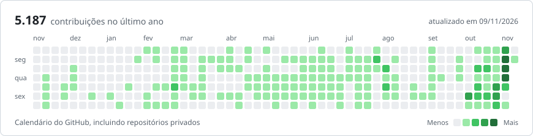
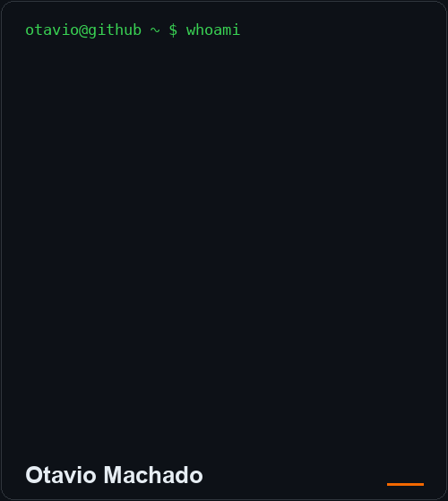
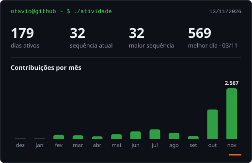
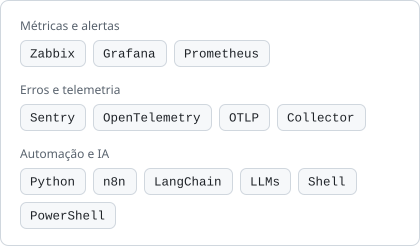
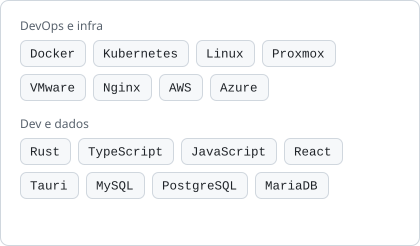
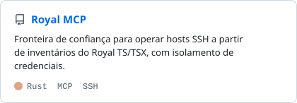
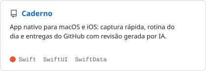
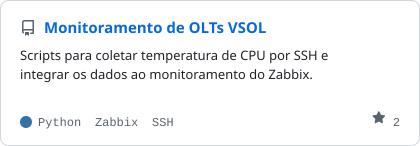
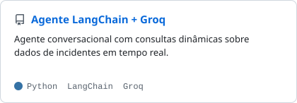

<a href="https://github.com/Otavio-Machado-Santos?tab=overview">
<picture>
  <source media="(prefers-color-scheme: dark)" srcset="assets/contributions-dark.svg">
  
</picture>
</a>

<picture>
  <source media="(prefers-reduced-motion: reduce)" srcset="assets/portrait-terminal-static.png">
  
</picture>

**Observabilidade · IA · automação · infraestrutura**

<a href="https://linkedin.com/in/ot%C3%A1vio-machado-santos"><picture><source media="(prefers-color-scheme: dark)" srcset="assets/contact-linkedin-dark.svg"></picture></a>
<a href="mailto:otaviomachado2003@gmail.com"><picture><source media="(prefers-color-scheme: dark)" srcset="assets/contact-email-dark.svg"></picture></a>
<a href="https://x.com/Machadokkj"><picture><source media="(prefers-color-scheme: dark)" srcset="assets/contact-x-dark.svg"></picture></a>

## Sobre mim

Gosto de transformar problemas em ferramentas que funcionam. Construo projetos que conectam **observabilidade, automação e IA**, de agentes e integrações a dashboards e aplicações desktop.

Em observabilidade, conecto **métricas, logs, traces e erros** para entender o comportamento da infraestrutura e das aplicações, investigar incidentes e dar contexto às operações. Uso **Python, Rust, TypeScript, n8n e LLMs** para explorar ideias e reduzir trabalho repetitivo, e conto o processo no [X](https://x.com/Machadokkj).

## Stack

<picture><source media="(prefers-color-scheme: dark)" srcset="assets/stack-1-dark.svg"></picture>
<picture><source media="(prefers-color-scheme: dark)" srcset="assets/stack-2-dark.svg"></picture>

## Projetos em destaque

<a href="https://github.com/Otavio-Machado-Santos/royal-mcp"><picture><source media="(prefers-color-scheme: dark)" srcset="assets/project-royal-mcp-dark.svg"></picture></a>
<a href="https://github.com/Otavio-Machado-Santos/Organizer_brain"><picture><source media="(prefers-color-scheme: dark)" srcset="assets/project-organizer_brain-dark.svg"></picture></a>
<a href="https://github.com/Otavio-Machado-Santos/Scripts-Olt-Vsol-Cpu-Temp-SSH"><picture><source media="(prefers-color-scheme: dark)" srcset="assets/project-scripts-olt-vsol-cpu-temp-ssh-dark.svg"></picture></a>
<a href="https://github.com/Otavio-Machado-Santos/agentLangchainGroqV1"><picture><source media="(prefers-color-scheme: dark)" srcset="assets/project-agentlangchaingroqv1-dark.svg"></picture></a>

<strong>Outros trabalhos em observabilidade e IA</strong>

- **NOC AI Dashboard:** Zabbix, Grafana e LLMs para análise de incidentes, com automações em n8n e painéis customizados.
- **GrafanaAI Studio:** aplicação desktop com Tauri, Rust, React e TypeScript para edição assistida de dashboards, com credenciais isoladas por projeto.
- **AI NOC Copilot:** agente conversacional em n8n e LangChain sobre uma base de incidentes ativos.

<strong>Últimos commits nos projetos públicos</strong>

<!-- public-commits:start -->

- **31/10/2026 · unopar-aulas-praticas:** [Aulas práticas UNOPAR 2026/2: código-fonte e evidências](https://github.com/Otavio-Machado-Santos/unopar-aulas-praticas/commit/df5d23b67dc9a56f62f73682d70e393c19356ae7) · `df5d23b`
- **10/10/2026 · conty-deteccao-views:** [docs: atualizar relatório das nove entregas com a auditoria de 10/10](https://github.com/Otavio-Machado-Santos/conty-deteccao-views/commit/971ca2a1084d128090fa5932ccdd0e9a40a68bf0) · `971ca2a`
- **10/10/2026 · conty-deteccao-views:** [docs: medir sensibilidade fora do dataset e corrigir exemplos do README](https://github.com/Otavio-Machado-Santos/conty-deteccao-views/commit/268ae54d840b9a76ce79965ed6348c73667fc16a) · `268ae54`
- **10/10/2026 · conty-deteccao-views:** [fix: exigir subida e queda abruptas e montar o motivo pelos sinais acionados](https://github.com/Otavio-Machado-Santos/conty-deteccao-views/commit/0c73a119d14302d82bca753dc58d463cd04bc658) · `0c73a11`

<!-- public-commits:end -->

## Certificações

- **Linux Essentials** — Linux Professional Institute (LPI), novembro de 2024.
- **Tuning em Zabbix** — 2024.

---

Calendário e números vêm do próprio GitHub e são regerados de hora em hora por um <a href="scripts/README.md">workflow deste repositório</a>, sem serviços externos.

